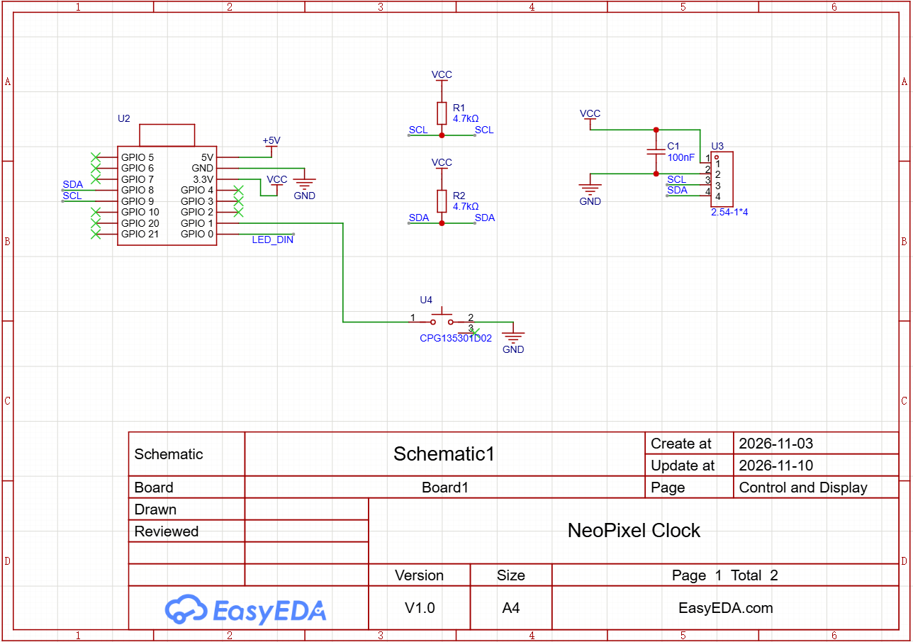
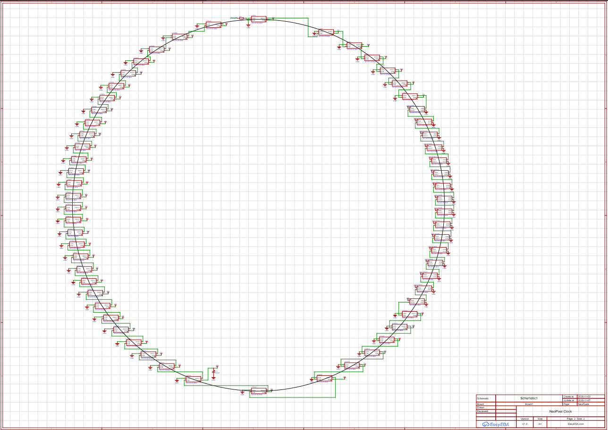
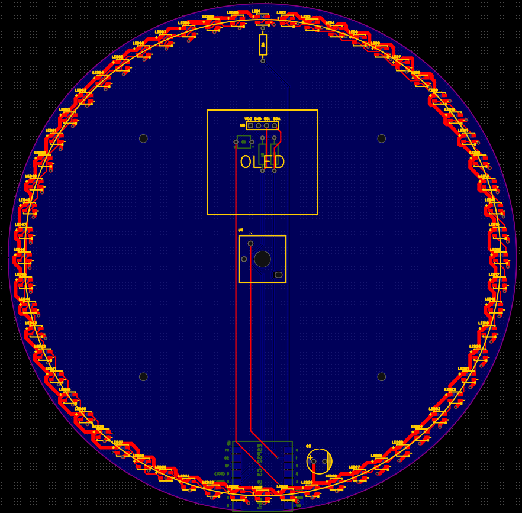
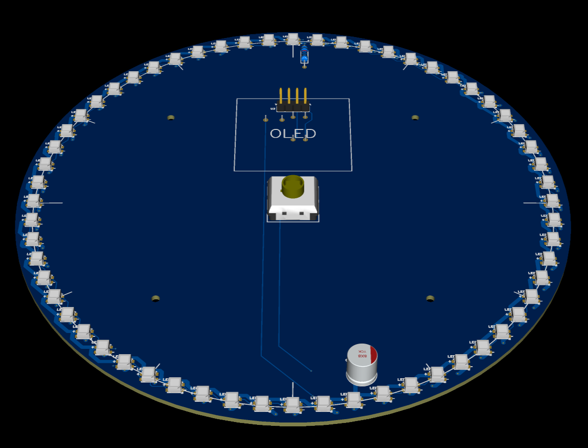
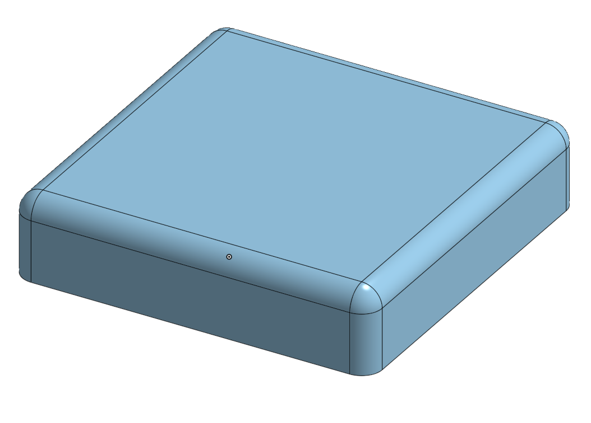
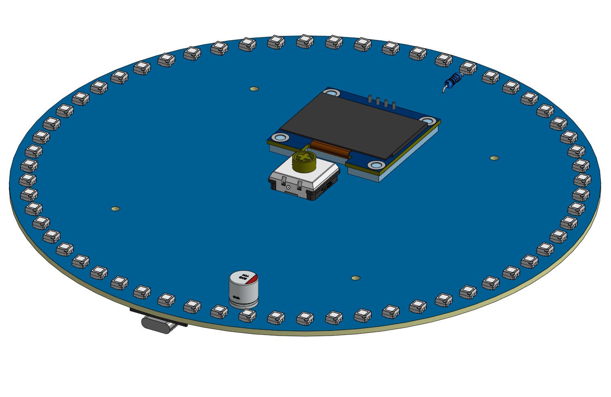

# NeoPixel-Clock
A NeoPixel clock that has NeoPixels around it to tell the time and an OLED display to show the current date, with a switch to change modes. It retrieves the date and time using the XIAO ESP32-C3 to get it using Wi-Fi. I will use MicroPython for the code.

I made this so I could have a neat-looking clock to tell the time and the date.

## PCB
I made the [PCB](https://github.com/araschke001-commits/NeoPixel-Clock/blob/main/PCB) for this clock using EasyEDA Pro. I added the source files as .json files, copying them from EasyEDA, but they seem to have errors.

Here are the images of my Schematic and PCB:

## 3d Model
I made a 3d model for the keycap needed to go onto the switch [here](https://github.com/araschke001-commits/NeoPixel-Clock/blob/main/3d%20Model/Keycap.step) and downloaded that and the assemblies into [this folder](https://github.com/araschke001-commits/NeoPixel-Clock/blob/main/3d%20Model).

I also made an assembly of the PCB with the PCB, all of the components, and the standoffs in [Onshape](https://cad.onshape.com/documents/e89dcb76a46dc59ac115dc7b/w/4f57b6784dfbcd5bab5b00c5/e/a79ab988bd4d98dd8b5cdadd?renderMode=0&leftPanel=false&uiState=6af36fa614cb796759583b23).

## Code
I made the code for this project in MicroPython, which you'll need to flash to the board.

I made some [test programs](https://github.com/araschke001-commits/NeoPixel-Clock/blob/main/Code/Test%20Programs) for this project and the [main program](https://github.com/araschke001-commits/NeoPixel-Clock/blob/main/Code/NeoPixel%20Clock%20Code.py). I had to download the [sh1106 module](https://github.com/araschke001-commits/NeoPixel-Clock/blob/main/Code/Modules/sh1106.py) for the OLED to work well.

In the main program, there are two modes (mode 0 and mode 1). Mode 0 is the one with the hours, minutes, and seconds showing while mode 1 is the one with hours, minutes, seconds, and fractions of a second showing. The fractions of the second go by 1/60 to match with the amount of LED's there are.

## BOM
This should be everything to make my project (or you can view the full BOM [here](https://github.com/araschke001-commits/NeoPixel-Clock/blob/main/BOM.csv)):

- 1x ESP32C3 Super Mini
- 60x WS2812B RGB LED's
- 1x 1.3" 128X64 White OLED
- 1x Kailh Choc Low Profile Switch
- 1x 100nF Capacitor
- 1x 10V 680uF Electrolytic Capacitor
- 1x 300pcs 1/4W 1% Resistor Pack
- 4x M2x10mm Steel Standoffs